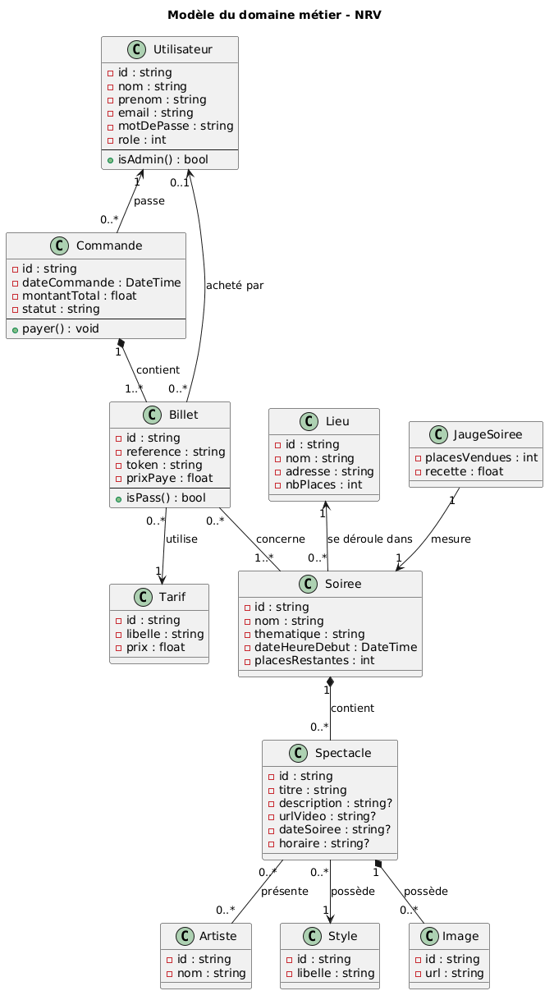
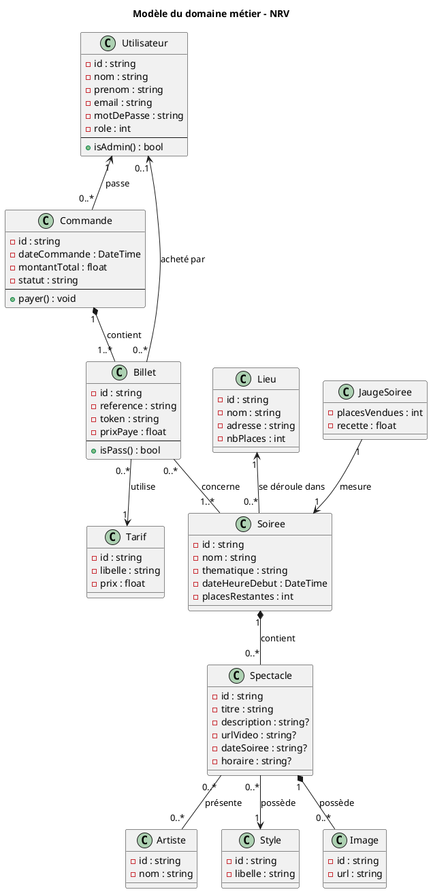

# Modèle du domaine métier

L’application permet de gérer un festival de spectacles :
- des soirées se déroulent dans des lieux
- chaque soirée contient des spectacles
- les spectacles sont associés à des artistes et à des styles
- les utilisateurs peuvent acheter des billets
- les billets sont regroupés dans des commandes
- le paiement vérifie les places restantes.

